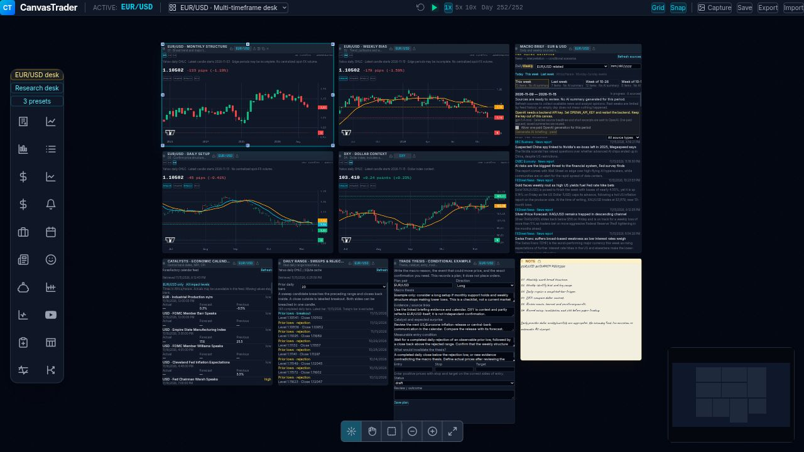

# Canvas Trader

An infinite-canvas market analytics workstation built with React 19. Drag, resize, and arrange specialised widgets — charts, news, sentiment, COT reports, portfolio sandbox, AI research, and more — across a free-form canvas, then save the layout and come back exactly where you left off.



*Example EUR/USD workspace with monthly, weekly and daily charts, dollar context, and macro research widgets.*

---

## Table of Contents

- [Overview](#overview)
- [Tech Stack](#tech-stack)
- [Getting Started](#getting-started)
- [Project Structure](#project-structure)
- [Canvas & Widgets](#canvas--widgets)
  - [Canvas Controls](#canvas-controls)
  - [Widget Types](#widget-types)
- [BeakChart Widget](#beakchart-widget)
  - [Drawing Tools](#drawing-tools)
  - [Indicators](#indicators)
  - [Pattern Detection](#pattern-detection)
- [Dashboards](#dashboards)
- [Simulation Engine](#simulation-engine)
- [Portfolio Sandbox](#portfolio-sandbox)
- [AI News & Research](#ai-news--research)
- [State Management](#state-management)
- [beak-charts Package](#beak-charts-package)
  - [Core Architecture](#core-architecture)
  - [Indicator Compute API](#indicator-compute-api)
  - [Plugin System](#plugin-system)
  - [React API](#react-api)
- [Performance](#performance)
- [Data Layer](#data-layer)
- [Keyboard Shortcuts](#keyboard-shortcuts)
- [Persistence](#persistence)
- [License](#license)

---

## Overview

Canvas Trader is a single-page application that replaces the traditional rigid grid dashboard with a fully free-form infinite canvas. Every widget is an independent, resizable node. You can build any layout — a single full-screen chart, a multi-monitor-style grid of panels, or loose clusters of related widgets — and save it to localStorage.

Key characteristics:

- **Infinite canvas** powered by ReactFlow — pan, zoom, drag, multi-select
- **Custom charting engine** (`@beak/charts`) written from scratch on the HTML Canvas API — no external chart vendor
- **Specialised widgets** covering price action, macro data, sentiment, positioning, and AI-assisted research
- **Pattern recognition engine** with six candlestick/price-structure patterns rendered directly on the canvas
- **Simulation mode** — replay historical data bar-by-bar at variable speed, with all widgets updating in sync
- **Paper trading sandbox** — record fills, partial closes and reversals with P&L separated by quote currency

---

## Tech Stack

| Layer | Library / Tool | Version |
|---|---|---|
| UI Framework | React | 19 |
| Build Tool | Vite | 7 |
| Language | TypeScript | 5.9 |
| Styling | Tailwind CSS | 4 |
| Canvas Engine | @xyflow/react (ReactFlow) | 12 |
| State | Zustand | 5 |
| Animation | Framer Motion | 12 |
| Charts (external) | lightweight-charts | 5 |
| Charts (custom) | @beak/charts (local package) | 0.1 |
| Visualisation | ECharts, Recharts | 6 / 3 |
| Screenshot | html-to-image | 1.11 |
| IDs | uuid | 13 |
| Date utilities | date-fns | 4 |

---

## Getting Started

Requirements: Node.js 22+, Python 3.14+ and [uv](https://docs.astral.sh/uv/).

Start the backend in terminal 1:

```sh
cd backend
uv sync --locked
uv run uvicorn canvas_backend.main:app --app-dir src --host 127.0.0.1 --port 8001
```

Start the frontend from the repository root in terminal 2:

```sh
npm ci
npm run dev -- --host 127.0.0.1 --port 5173
```

Open http://127.0.0.1:5173/. API docs: http://127.0.0.1:8001/docs.

Click **EUR/USD desk** for four charts (EUR/USD monthly/weekly/daily and DXY daily), macro briefing, economic calendar, liquidity scanner and a conditional example plan. Existing dashboards are preserved. **3 presets** adds further research layouts.

`VITE_API_BASE_URL` defaults to `http://127.0.0.1:8001/api`. Optional paid AI generation requires `OPENAI_API_KEY` in the **backend environment**, followed by a restart and an explicit generation action in the widget. Do not expose keys in Vite variables or canvas exports. See [backend setup](backend/README.md), [briefing guide](docs/BRIEFING_GUIDE.md) and [EUR/USD desk guide](docs/EURUSD_DESK.md).

```sh
npm test
npm run build
# Backend fixture tests, from backend/:
PYTHONPATH=src uv run python -m unittest discover -s tests -p 'test_*.py'
```

The local `@beak/charts` package resolves through Vite aliases; no separate publishing step is needed. Local databases, credentials and installed dependencies are excluded from git.

---

## Project Structure

```
canvas-trader/
├── src/
│   ├── App.tsx                      # Root component — loads layout on mount
│   ├── main.tsx                     # Entry point
│   │
│   ├── canvas/
│   │   ├── CanvasEngine.tsx         # ReactFlow setup, keyboard shortcuts
│   │   ├── WidgetNode.tsx           # Per-node dispatcher → widget components
│   │   └── WidgetContainer.tsx      # Shared header, resize handles, controls
│   │
│   ├── components/
│   │   ├── Toolbar.tsx              # Top bar — dashboards, capture, simulation
│   │   ├── WidgetSidebar.tsx        # Left panel — drag-to-add widget palette
│   │   └── SelectionOverlay.tsx     # Rubber-band area capture
│   │
│   ├── widgets/                     # One directory per widget type
│   │   ├── BeakChartWidget/         # Custom canvas chart (main charting widget)
│   │   ├── ChartWidget/             # lightweight-charts integration
│   │   ├── WatchlistWidget/
│   │   ├── PortfolioWidget/
│   │   ├── NewsWidget/
│   │   ├── FinancialsWidget/
│   │   ├── SentimentWidget/
│   │   ├── YieldsBondsWidget/
│   │   ├── COTWidget/
│   │   ├── AlertsWidget/
│   │   ├── EarningsWidget/
│   │   ├── ValuationWidget/
│   │   ├── InterestRatesWidget/
│   │   ├── AINewsWidget/
│   │   ├── YoutubeWidget/
│   │   └── StickerWidget/
│   │
│   ├── store/
│   │   ├── useCanvasStore.ts        # Nodes, edges, dashboards, canvas mode
│   │   ├── useTickerStore.ts        # Global ticker broadcast
│   │   ├── useSimulationStore.ts    # Playback index and speed
│   │   ├── usePortfolioStore.ts     # Paper trades and positions
│   │   ├── useAlertStore.ts         # Price alerts
│   │   └── useAISettingsStore.ts    # LLM provider and API key
│   │
│   ├── services/
│   │   ├── marketService.ts         # Data cache and helper calculations
│   │   ├── simulationService.ts     # Playback utilities
│   │   └── aiService.ts             # LLM API integration
│   │
│   ├── mock-data/
│   │   └── generators.ts            # Seeded pseudo-random OHLCV + macro data
│   │
│   ├── types/index.ts               # Shared type definitions
│   └── utils/
│       ├── capture.ts               # Screenshot and download helpers
│       └── format.ts                # Number and date formatting
│
└── packages/
    └── beak-charts/                 # Local charting library (@beak/charts)
        └── src/
            ├── core/                # Chart, Viewport, Renderer, DataManager
            ├── series/              # Candlestick, Line, Histogram, Bar
            ├── scales/              # TimeScale, PriceScale
            ├── interaction/         # Pan, Zoom, Crosshair, Drawing handlers
            ├── drawing/             # HorizontalLine, TrendLine, Box, Arrow, Fibonacci
            ├── indicators/          # Compute functions + canvas plugins
            ├── plugins/             # PluginHost
            ├── theme/               # dark / light themes
            └── react/               # Optional React wrapper and hook
```

---

## Canvas & Widgets

### Canvas Controls

The bottom control bar switches between three interaction modes:

| Mode | Behaviour |
|---|---|
| **Move** | Click any widget to drag it. Default mode. |
| **Pan** | Drag the canvas background to scroll. |
| **Select** | Rubber-band drag to multi-select widgets. |

Additional controls:

- **Zoom in / Zoom out** — buttons or scroll wheel
- **Fit to view** — centres all visible widgets with padding
- **Grid** — toggle dot grid (20 px pitch) on/off
- **Snap to grid** — widgets snap to 20 px grid when moving or resizing
- **Lock** — per-widget lock prevents accidental repositioning
- **Mini-map** — bottom-right overview of the full canvas

### Widget Types

| Type | Default Size | Description |
|---|---|---|
| **BeakChart** | 620 × 420 | Custom canvas charting engine with full drawing and indicator support — see below |
| **Chart** | 620 × 420 | TradingView lightweight-charts integration for OHLC + volume |
| **Watchlist** | 300 × 400 | Track pairs; clicking a row broadcasts the ticker to all synced widgets |
| **Financials** | 400 × 350 | GDP, CPI, unemployment, and interest rate data per currency |
| **Valuation** | 360 × 300 | Rate differential, carry trade score, inflation-adjusted metrics |
| **Interest Rates** | 400 × 340 | Central bank rates table with carry calculations and historical trend |
| **Alerts** | 380 × 350 | Create price-level alerts; triggered alerts show inline |
| **Portfolio Sandbox** | 500 × 400 | Paper trading — enter buy/sell at any price, track P&L and equity curve |
| **Economic Calendar** | 400 × 320 | Upcoming central bank meetings, NFP, CPI, and other high-impact events |
| **News Feed** | 420 × 450 | Ticker-contextual headlines with bullish / bearish / neutral sentiment labels |
| **Sentiment** | 400 × 420 | Sentiment gauge, directional signals, and historical sentiment chart |
| **YouTube Player** | 480 × 360 | Embed any YouTube video by URL |
| **COT Report** | 420 × 420 | CFTC Commitment of Traders — commercial, non-commercial, and net positioning |
| **Yields & Bonds** | 400 × 360 | US Treasury yield curve, real yields (TIPS), and historical spread |
| **AI News & Research** | 440 × 480 | LLM-powered news summariser and market researcher |
| **NOTE (Sticker)** | 220 × 200 | Free-form sticky note with the Caveat handwriting font |

Each widget has a shared header providing:

- **Ticker input** — override the widget's ticker independently of the global broadcast
- **Sync button** — re-link to the global ticker
- **Duplicate** — clone the widget at a 40 px offset
- **Delete (×)** — remove the widget

---

## BeakChart Widget

BeakChart is the primary charting widget, built entirely on the `@beak/charts` package. It renders on an HTML Canvas element — no SVG, no external chart vendor.

### Chart Types

Switch between Candlestick, Bar, and Line from the top toolbar inside the widget.

### Drawing Tools

Accessed via the vertical toolbar on the left edge of the chart:

| Tool | Description |
|---|---|
| Trend Line | Draw a line between two anchor points; extends to the viewport edge |
| Horizontal Line | Infinite horizontal price level |
| Box | Rectangle spanning a price and time range |
| Arrow Up / Down | Annotate a specific bar with a directional arrow |
| Fibonacci Retracement | Two-point fib with customisable levels (defaults: 0, 0.236, 0.382, 0.5, 0.618, 0.786, 1.0) |

Drawings are selectable, draggable (via anchor handles), and deletable. Fibonacci levels are editable through an in-chart panel.

### Indicators

Opened via the **Indicators** button. Indicators are split across three tabs:

**Indicators tab:**

| Name | Type | Placement |
|---|---|---|
| Volume | Histogram (coloured by candle direction) | Overlay |
| SMA | Configurable period, source, offset, style | Overlay |
| EMA | Configurable period, source, offset, style | Overlay |
| Bollinger Bands | Period, std-dev multiplier; upper/middle/lower bands | Overlay |
| Awesome Oscillator | 5/34 SMA of median; histogram | Bottom panel |
| RSI | Period, overbought/oversold levels | Bottom panel |
| MACD | Fast/slow/signal periods; MACD + signal line + histogram | Bottom panel |
| ATR | Period; Wilder's smoothing | Bottom panel |
| ZigZag | Deviation % threshold; swing high/low lines | Overlay |
| Williams Fractals | 5-bar up/down fractal markers | Overlay |

Each indicator is configurable (period, source, colour, line width, style, offset) and can be toggled, duplicated, or removed from the active indicators overlay.

**Strategies tab:** Coming soon.

**Patterns tab — see next section.**

### Pattern Detection

Patterns are detected on the full price series and drawn as canvas overlays via a plugin system. Each pattern can be added multiple times with different colour settings.

| Pattern | Marker | Detection Logic |
|---|---|---|
| **Kangaroo Tail** | Triangle ▲▼ | Body < 30 % of range; body sits in the upper/lower 35 % of the range; body within previous candle's range; tail pokes outside previous candle's range |
| **Engulfing Candle** | Circle ● | Current candle is directionally opposite to previous; current high ≥ prev high and current low ≤ prev low (full range engulf) |
| **Inside Bar** | Diamond ◆ | Current high ≤ prev high and current low ≥ prev low (fully contained) |
| **Open Lines** | Dashed horizontal lines | Draws the session open price for daily (D), weekly (W), and monthly (M) periods as horizontal dashed lines spanning each session |
| **ZigZag** | Connected line with pivot dots | Confirmed swing highs and lows filtered by a deviation % threshold |
| **Williams Fractals** | Small triangle | 5-bar fractal: centre bar is the highest high / lowest low of the five |

**Open Lines settings** (per indicator instance):

- Lookback period in days (default 90, i.e. ~3 months)
- Toggle each of Daily / Weekly / Monthly individually
- Separate colour picker for each
- Configurable UTC start hour for each period (e.g. set 17 for a 17:00 UTC daily session open)

---

## Dashboards

Dashboards group widgets into named views. Only the widgets belonging to the active dashboard are shown; switching dashboards fits the view to that set.

- **Create from selection** — switch to Select mode, rubber-band around the desired widgets, then use the Toolbar to create a named dashboard from the selection
- **Rename / Delete** — via the dashboard dropdown in the Toolbar
- **All widgets** view — select "All" to show every widget regardless of dashboard assignment
- Layout persists to localStorage including dashboard assignments

---

## Simulation Engine

The simulation bar in the Toolbar lets you replay market data as if time is advancing in real time.

- **Play / Pause** — starts or stops automatic bar-by-bar advancement
- **Speed** — multiplier controlling how fast bars advance
- **Scrub** — drag the progress indicator to jump to any bar in the dataset
- **Price-based views** follow the replay bar index; instrument dates can differ where histories have gaps. News, calendar, macro and positioning widgets retain their source observation dates and do not replay historical news.

This makes Canvas Trader useful as a manual backtesting / chart reading practice environment.

---

## Portfolio Sandbox

The Portfolio widget provides a zero-risk paper trading environment:

- Enter a buy or sell at the current simulated price (or any manually entered price)
- Open positions are tracked with quantity, entry price, current price, and unrealised P&L
- Closed trades accumulate realised P&L
- Partial closes and reversals are accounted for; quote currencies remain separate and missing prices show unavailable P&L. No synthetic equity curve is displayed.
- Positions update automatically as the simulation advances

---

## AI News & Research

**AI Macro Briefing** archives public headlines, short excerpts and calendar events, grouped by day or Monday–Sunday week in the browser timezone. Today/This week/Last week shortcuts, historical dates, global/pair scope and source-type filters help navigate evidence.

Refreshing sources is free and makes no AI call. Optional server-side OpenAI generation requires explicit paid consent for one period. Saved summaries are persisted with their cited evidence snapshot; unchanged summaries are reused. Drivers, analyst perspectives, counterarguments and conditional scenarios remain interpretations of sampled evidence. Missing coverage is not neutral sentiment. Future calendar entries are labelled scheduled risks.

The optional macro shortlist reads saved analyses from `ANALYSIS_API_URL`; it does not request new paid generation. Legacy direct-provider AI modules remain in the source tree but are not the active briefing integration. See the [briefing guide](docs/BRIEFING_GUIDE.md).

---

## State Management

All state is managed through [Zustand](https://github.com/pmndrs/zustand) stores. There is no Context API or Redux.

### `useCanvasStore`

The primary store. Owns the ReactFlow `nodes` and `edges` arrays and all canvas-level state.

| Key state | Description |
|---|---|
| `nodes` | All widget nodes with position, size, and `WidgetConfig` |
| `edges` | Connections between widgets |
| `dashboards` | Named dashboard definitions |
| `activeDashboardId` | Which dashboard is currently visible |
| `canvasMode` | `'pan'` \| `'select'` \| `'move'` |
| `showGrid` / `snapToGrid` | Grid display and behaviour |
| `captureMode` | `'none'` \| `'area'` for screenshot mode |
| `resizeGuides` | Temporary alignment guide lines during resize |

Key methods: `addWidget`, `removeWidget`, `removeSelectedWidgets`, `duplicateWidget`, `updateWidgetData`, `createDashboardFromSelection`, `saveLayout`, `loadLayout`.

Layout is debounce-saved to `localStorage` 2 seconds after any node or edge change.

### `useTickerStore`

Holds a single `globalTicker` string (e.g. `'EUR/USD'`). Widgets with sync enabled subscribe to this and re-render when it changes. The Watchlist widget is the primary broadcaster.

### `useSimulationStore`

| State | Description |
|---|---|
| `playing` | Whether the simulation is advancing |
| `speed` | Bars per second |
| `currentIndex` | The current bar index across all widgets |
| `maxIndex` | Total bars available in the dataset |

### `usePortfolioStore`

Stores a flat array of `Trade` objects. A derived `getPositions()` selector aggregates them into open positions with current P&L.

### `useAlertStore`

Stores `Alert` objects. `checkAlerts(currentPrice)` evaluates all active alerts on each simulation tick and marks triggered ones.

### `useAISettingsStore`

Persisted to `localStorage`. Stores the selected LLM provider, model, API key, and news source preferences.

---

## beak-charts Package

`packages/beak-charts` is a self-contained charting library (`@beak/charts`) consumed only by this application. It is resolved locally via a Vite path alias — no npm publishing required.

### Core Architecture

```
Chart (entry point)
├── DataManager        — stores raw OHLCV series
├── Viewport           — maps bar indices ↔ pixel X, price ↔ pixel Y
├── Renderer           — orchestrates draw calls each animation frame
├── Series (multiple)  — CandlestickSeries, LineSeries, HistogramSeries, BarSeries
├── Scales             — TimeScale (X axis), PriceScale (Y axis)
├── DrawingManager     — holds all user-drawn overlay objects
├── PluginHost         — manages registered plugins
└── Interaction        — EventRouter → PanHandler, ZoomHandler, CrosshairHandler,
                         AxisDragHandler, DrawingInteractionHandler
```

### Indicator Compute API

All computation functions are pure functions over `PriceBar[]`:

```ts
computeSmaValues(values, period)
computeEmaValues(values, period)
computeBBValues(prices, { period, source, bbStdDev })
computeAtrValues(prices, period)
computeRsiValues(prices, period)
computeMacdValues(prices, fastPeriod, slowPeriod, signalPeriod)
computeAoValues(prices)
computeFractals(prices)            → { up: FractalPoint[], down: FractalPoint[] }
computeKangarooTails(prices)       → { bullish, bearish }
computeEngulfingCandles(prices)    → { bullish, bearish }
computeInsideBars(prices)          → InsideBarPoint[]
computeOpenLines(prices, config)   → { daily, weekly, monthly }
computeZigZag(prices, deviationPct)→ ZigZagPoint[]
```

### Plugin System

Plugins hook into the render loop via named lifecycle hooks:

```ts
type Plugin = {
  name: string;
  hooks: Partial<Record<
    'beforeDraw' | 'afterDraw' | 'onCrosshairMove' | 'onVisibleRangeChange' | 'onResize',
    (context: PluginContext) => void
  >>;
};

type PluginContext = {
  ctx: CanvasRenderingContext2D;
  viewport: PluginViewport;   // barIndexToX(), priceToY(), chartWidth, barSpacing …
  dataManager: PluginDataManager;
  theme: Theme;
};
```

The six built-in plugins (`createFractalsPlugin`, `createKangarooTailPlugin`, `createEngulfingPlugin`, `createInsideBarPlugin`, `createOpenLinesPlugin`, `createZigZagPlugin`) all follow this interface and receive their data via a `getData` callback so they always have the latest computed results without needing to re-register.

### React API

Imported from `@beak/charts/react`:

```ts
import { BeakChart, useBeakChart } from '@beak/charts/react';
import type { BeakChartRef, BeakChartProps } from '@beak/charts/react';
```

**`<BeakChart />`** — React component that mounts and owns the chart lifecycle. Key props:

| Prop | Type | Description |
|---|---|---|
| `options` | `Partial<ChartOptions>` | Chart configuration (crosshair, theme, etc.) |
| `theme` | `Theme` | `dark` or `light` theme object |
| `ref` | `BeakChartRef` | Imperative handle exposing the `chart` instance |

**`useBeakChart()`** — convenience hook that creates a typed `ref` and a stable `getChart()` accessor:

```ts
const { ref, getChart } = useBeakChart();
// Pass ref to <BeakChart ref={ref} />
// Call getChart() anywhere to access the Chart instance imperatively
```

**`BeakChartRef`** — `{ chart: Chart | null }`. The `chart` property is the raw `Chart` instance; all series, drawings, and plugins are accessible through it.

---

## Performance

`@beak/charts` is built for low-overhead animation-frame rendering:

- **DataManager caching** — `getTotalBars()`, `getSeriesByPriceScale()`, and `getTimeAtIndex()` results are cached and invalidated on structural changes, eliminating per-frame allocations.
- **Allocation-free price range update** — `_updatePriceRange()` uses series IDs rather than full series objects to avoid allocating on every draw call.
- **Canvas context optimisation** — `getContext('2d', { alpha: false, willReadFrequently: false })` lets the browser use an opaque back-buffer.
- **Single RAF per frame** — multiple `requestDraw()` calls within one frame coalesce into a single `requestAnimationFrame` paint.
- **ResizeObserver throttling** — resize events are deduplicated through a `requestAnimationFrame` gate; the pending RAF is cancelled on `destroy()`.
- **Options / theme sync without remount** — `Chart.setOptions()` deep-merges changes and triggers a redraw in place; `CrosshairHandler.setConfig()` keeps crosshair state in sync without re-registering.
- **Visibility-aware rendering** — an `IntersectionObserver` on the container skips draw calls when the chart is off-screen and resumes when it re-enters the viewport.

---

## Data Layer

The active frontend uses the bundled FastAPI service. Prices come from Yahoo daily OHLC with a local SQLite cache. Weekly/monthly chart candles are aggregates of observed daily sessions, cut off before aggregation during replay; edge periods may be incomplete. There is no intraday feed or comprehensive spot-FX volume. Gold uses the explicitly labelled GC=F futures proxy.

Research adapters provide annual World Bank observations, FRED rates/yields, CFTC weekly futures positioning, public news feeds and ForexFactory calendar entries. Availability varies; missing data stays unavailable. Annual observations are not interpolated into daily data, and futures positioning is not market-wide spot-FX order flow. Rates/yields can be lagged; calendar actuals may be missing.

The frontend cache deduplicates requests, expires them and separates history lengths. Missing or malformed provider data does not silently become synthetic observations. Legacy generator modules remain in the tree but are not used by the active market dataset endpoint.

Supported instruments include EUR/USD, GBP/USD, USD/JPY, USD/CHF, AUD/USD, USD/CAD, NZD/USD, EUR/GBP, EUR/JPY, GBP/JPY, AUD/JPY, EUR/CHF, XAU/USD and DXY.

---

## Keyboard Shortcuts

| Key | Action |
|---|---|
| `Delete` / `Backspace` | Delete all selected widgets (when focus is not in a text input) |

Inside the **BeakChart** drawing toolbar:
- Click a tool to activate it; click again or press `Escape` to deactivate
- Selected drawings can be deleted via the toolbar delete button

---

## Persistence

All layout data is saved to `localStorage` under the key `canvas-trader-layout`.

Saved state includes:

- Widget positions, sizes, and configurations
- Dashboard definitions and active dashboard
- ReactFlow edges (widget connections)

Saving is automatic, debounced to 2 seconds after any change. On page load `loadLayout()` restores the last saved state. If no saved state exists the canvas starts empty — widgets are added manually from the sidebar.

The following stores also persist independently to `localStorage`:

- `useAISettingsStore` — LLM provider, model, API key, and news source preferences

---

## License

MIT
